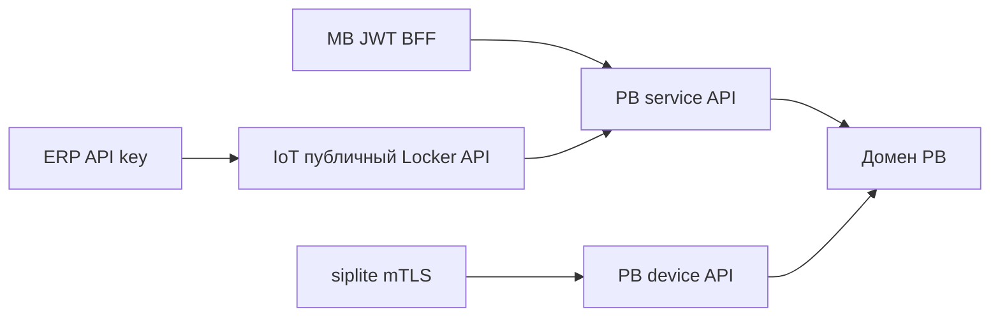
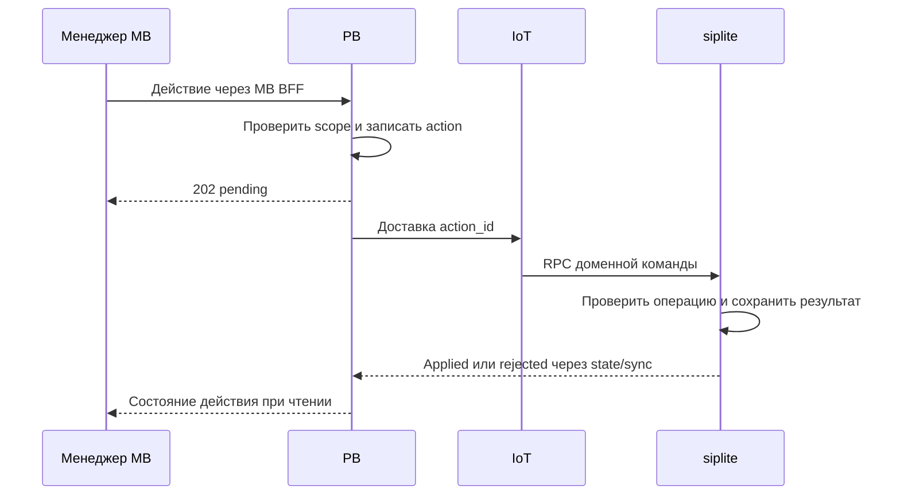
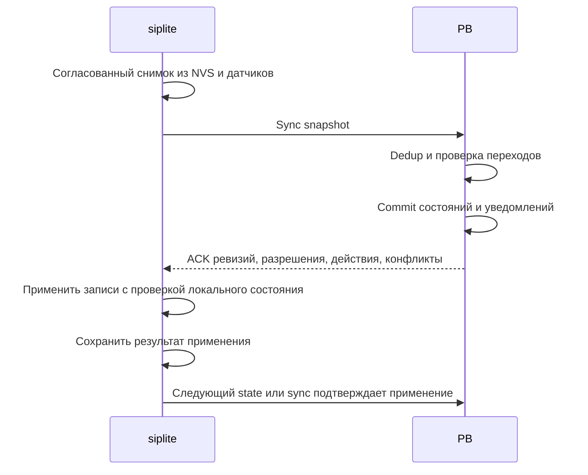

# Контракты локеров и выделенная документация API

Дата: 2026-10-18. Редакция 1. Статус: проект технических контрактов для согласованных [правил домена](etran_arch-lockers-mvp.md). Маршруты, DTO и wire-коды пока не реализованы.

## 1. Границы API



| Граница | Предлагаемый префикс | Авторизация |
|---|---|---|
| ERP → IoT | /api/lockers/v1 | Существующий API-key контур с tenant и scope |
| Browser → MB | /api/lockers | JWT и явные permissions роли 6 |
| MB/IoT → PB | /api/internal/lockers/v1 | Сервисная identity, проверенный org_id и actor |
| siplite → PB | /api/lockers/device/v1 | Аутентифицированная terminal identity/mTLS |

PB не доверяет tenant из произвольного JSON внешнего клиента. org_id нормализуется в int на auth boundary. IoT и MB не получают прямой write-доступ к таблицам домена. Существующий выпуск API-ключей MB переиспользуется; фактический способ валидации этих ключей фасадом IoT надо подтвердить по обоим репозиториям до реализации. Второй несогласованный реестр ключей не создаётся.

## 2. Выделенный Scalar

### 2.1. URL и аудитория

Публичный фасад IoT обслуживает отдельную документацию:

| URL проекта | Содержание |
|---|---|
| /lockers/docs | Scalar API Reference домена локеров |
| /lockers/openapi.json | Только публичная OpenAPI-схема /api/lockers/v1 |

Новый раздел не размещается на существующем /docs. Общая документация не становится единственной точкой входа в домен. Внешняя схема не содержит PB device/service endpoints, пользовательские JWT-методы MB, внутренние ключи и аппаратные команды.

```mermaid
flowchart TD
    PAGE[GET /lockers/docs] --> SCALAR[Scalar UI]
    SCALAR --> SPEC[GET /lockers/openapi.json]
    SPEC --> ROUTES[Публичные routes локеров]
    SCALAR -->|Проверка запроса с API key| API[/api/lockers/v1]
```

Scalar поддерживает отдельный маршрут страницы и выбор OpenAPI URL; это подтверждено [официальной интеграцией FastAPI](https://scalar.com/products/api-references/integrations/fastapi). Конкретная версия зависимости фиксируется при реализации.

### 2.2. Организация схемы

Предпочтение: отдельный набор routes и генерация доменной схемы из тех же DTO/handlers, которыми обслуживается API. При необходимости применяется mounted subapplication внутри существующего процесса IoT, без нового сервиса. Выбор зависит от действующей структуры IoT, которую нужно проверить перед реализацией.

Фильтрации по видимому тегу в UI недостаточно: paths и components доменного JSON должны содержать только доступные публичному потребителю контракты и их транзитивные зависимости. Не создавать вручную вторую несинхронизируемую OpenAPI-копию.

Группы Scalar: Orders, Lockers and cells, Administrative actions, Synchronization semantics, Webhooks. Описание асинхронности и ссылка на реестр расхождений включаются в descriptions соответствующих операций. Ответ 202 объясняет принятие намерения, а не исполнение на устройстве.

Документация может содержать общедоступную схему без данных арендаторов; выполнение API всегда требует credentials. Используются только условные примеры. Автоматическое сохранение ключа браузером не включается; внешнее проксирование пользовательских запросов через сторонний сервис не требуется. Asset Scalar закрепляется по версии; предпочтительно обслуживать его штатными static assets.

При реализации проверить: оба URL доступны по выбранному ingress, относительные servers корректны за proxy, все $ref разрешаются, operationId уникальны, internal/device routes отсутствуют, существующий /docs сохраняет поведение, Try It отправляет запрос в правильный API с настоящей серверной авторизацией. В этой задаче страница не публикуется.

## 3. Общие правила запросов

- ID заказа/операции/разрешения/решения — непрозрачные строки; не ограничиваются длиной NVS-ключа.
- Коды доступа — строки, не integers. Время — UTC с явной зоной; elapsed-time не определяется сравнением часов PB и устройства.
- Idempotency-Key обязателен для создающих команды операций. Повтор с тем же ключом и тем же нормализованным телом возвращает прежний результат; другое тело возвращает 409.
- PATCH и административные действия несут ожидаемую версию заказа/операции. Устаревший контекст возвращает 409 с текущим состоянием без кодов.
- 201 — создан серверный объект; 202 — принято ожидающее исполнения решение; 200 — сохранённый ответ/чтение; 409 — конфликт; 422 — невалидные данные; 401/403 — auth/scope; 429 — лимит.
- Общая ошибка проекта: code, message, request_id, retryable, current_revision при допустимом раскрытии. Авторизация применяется до раскрытия существования чужого заказа.
- Нет общедоступного PATCH status. Каждое действие имеет назначение и проверяемые предусловия.

## 4. Публичные операции

Пути в таблице относительны к /api/lockers/v1. Минимальная техническая поверхность, а не утверждённые wire-имена.

| Метод и путь | Семантика |
|---|---|
| POST /orders | Создать заказ конкретного локера; сервер генерирует коды |
| GET /orders | Список в tenant scope, фильтры, cursor/limit, без кодов |
| GET /orders/{id} | Состояние, намерение, подтверждение устройства и свежесть |
| PATCH /orders/{id} | Только неконфликтующие атрибуты, явный allowlist |
| DELETE /orders/{id} | Только new без выданного/возможно доставленного разрешения; атомарно относительно authorize |
| POST /orders/{id}/authorize | Выдать разрешение предзагрузки на закреплённый локер |
| POST /orders/{id}/cancel | Запрос отмены; после authorize возможен 202 |
| POST /orders/{id}/actions | Административное действие, включая подтверждение процедуры отмены |
| GET /orders/{id}/operations | Бизнес-операции и история принятых решений |
| GET /actions/{id} | Pending/applied/rejected, причина, подтверждённая версия |
| GET /lockers | Разрешённые локеры и свежесть их состояния |
| GET /lockers/{id}/cells | Карта ячеек, sensor time, allocation, связь с заказом |
| GET /orders/{id}/access-codes | Отдельное разрешение просмотра кодов, аудит и no-store |

Create/authorize разделены семантически. UI может выполнять их последовательно одним пользовательским действием, явно показывая, что заказ становится исполнимым автономно. Создание не резервирует ячейку. external_id уникален в согласованной области организации/внешнего источника.

После authorize допускается менять только серверные примечания/метки, не влияющие на исполнение. Коды, локер, barcode, сроки, предпочтительная ячейка и политика доступа не меняются обычным PATCH: отмена прежнего разрешения и новое назначение требуют согласованной процедуры. Это ограничивает сложность применения изменений на устройстве.

Проект create DTO: external_id, locker_id, item_ref, description, preferred_cell_id?, place_by_barcode=false, placement_expires_at?, policy_overrides?. Сервер копирует актуальные defaults в заказ, чтобы изменение настроек не меняло молча выданные разрешения.

Проект read DTO: order_id, lifecycle, admin_intent, cancel_basis?, device_cancel_applied, server_revision, device_revision?, last_device_observed_at?, last_sync_at?, active_operation?, pending_action?, freshness. Поле freshness не утверждает, что устройство online только на основании старого heartbeat.

## 5. Административные команды



| Тип проекта | Предусловие и результат |
|---|---|
| confirm_placement | Только placement_uncertain ожидаемой operation_id; закрытая дверь, нет текущего fault; перевод в stored |
| confirm_empty | Менеджер подтверждает отсутствие ТМЦ; блокировка кодов, cancelled; ячейка free только после закрытия и без fault |
| require_withdrawal | Блокировка клиентского кода после применения; код изъятия сохраняется |
| request_cancel | Если движения нет — отменить разрешение; если движение было — запрет клиента и изъятие |
| confirm_cancel_procedure | Только PB: оператор отдельно уведомлён; фиксируется административное основание, техническая отмена продолжает доставляться |

DTO: action_id, order_id, operation_id при наличии, grant_id, expected_revision, action_type, reason, actor, created_at. На устройстве actor не даёт дополнительных прав: источником команды является доверенный хост. Повтор action_id возвращает прежний результат. Решение с иной операцией или завершённой выдачей отклоняется, физический результат не откатывается.

Результаты применения передаются и в периодической сверке: потеря RPC/HTTP ACK не должна заставить менеджера создавать новое действие вслепую. Транспортный RPC RES не равен PB-подтверждению сохранения бизнес-состояния.

## 6. Device API и контракт состояния

| Метод проекта | Назначение |
|---|---|
| POST /state | Немедленная передача полного состояния изменённого заказа/операции |
| POST /sync | Двусторонняя сверка списка заказов, результатов, решений и карты ячеек |

Пути относительны к /api/lockers/device/v1. Идентичность определяется auth dependency; locker_id/SN в сообщении только сверяются с ней. Обычные запросы состояния не содержат открытых кодов.

Оболочка устройства: protocol_version, storage_generation, snapshot_id, snapshot_revision, complete, orders[], cells[], action_results[]. Запись заказа: order_id, grant_id, operation_id?, device_revision, phase, cell_id?, result?, uncertainty_reason?, observed_at?, clock_quality, applied_action_id?. У snapshot есть локальная согласованная точка считывания; сеть не держит блокировку физической операции.

device_revision монотонна внутри записи и storage_generation, сохраняется вместе с состоянием. Обычная перезагрузка generation не меняет. Потеря/переинициализация хранилища создаёт новую generation и запускает recovery, не трактуется как пустой локер.

Ответ PB: accepted_records[{order_id, operation_id, device_revision}], grants[], actions[], conflicts[], server_revision, server_time. ACK выдаётся только после транзакционного сохранения принятого состояния. Устройство очищает завершённую запись только если подтверждена именно её актуальная ревизия и не остаётся ожидающего закрытия/неопределённости. Потерянный ответ компенсируется повторным снимком.

## 7. L2 — сверка



Триггеры: период порядка 10 минут, ввод кода размещения при доступной сети, восстановление соединения; немедленные state-запросы ускоряют видимость, но не являются единственным каналом. При серии ошибок используется ограниченный backoff; параллельные sync одного устройства сериализуются.

### 7.1. Правила слияния

1. Сначала валидировать принадлежность, generation, полные записи и ревизии. Невалидная запись не должна приводить к ACK очищаемого результата.
2. Принять новые наблюдения устройства по допустимым переходам, включая пропущенные промежуточные серверные состояния. Если PB видел authorized, а снимок уже collected, сохраняется конечный факт без выдуманных точных времён промежуточных стадий.
3. Не применять правило «последний timestamp победил». Server revision версионирует намерения, device revision — локальные наблюдения; их числовые значения не сравниваются между собой.
4. Сформировать действующие разрешения и административные решения с контекстом операции. Устройство повторно проверяет локальную фазу при применении, поскольку она могла измениться после снимка.
5. Отсутствие записи не означает выдачу, отмену или пустоту. complete=false и незавершённые страницы никогда не используются для выводов об отсутствии.
6. Каждая запись принятого результата и связанное бизнес-уведомление фиксируются вместе. Дубли не повторяют уведомление как новый переход.

### 7.2. Снимок без очереди событий

Устройство хранит текущее состояние и конечные неподтверждённые результаты, не все промежуточные события. Полная хронология RAW не восстанавливается. Карта ячеек включает только текущее наблюдение; бизнес-история PB содержит известные переходы с различением device_observed_at и server_received_at.

Если объём требует страниц, у них общий snapshot_id, total/complete и snapshot_revision. Частичный ответ сервера не объявляет весь снимок принятым. Лимиты предзагрузки и резерва завершённых записей задаются по измеренному размеру NVS. При потере NVS PB не загружает прежние коды безусловно: сначала административная сверка содержимого и привязок.

## 8. RPC и RAW

Существующий IoT транспорт доставляет разрешения/административные решения либо сигнал необходимости синхронизации. Числовые методы, event_type_code и теги не выделяются этим документом. Новых MQTT-топиков не предлагается. Команды не retained; штатные correlation/TTL сохраняются.

Контракт верхнего уровня: RPC исполняется в siplite и изменяет доменное разрешение/решение; аппаратное действие выполняется только локальной машиной состояний по соответствующим предусловиям. RPC delivery завершается штатным RES. Обязательный RAW evt не является условием успеха. Бизнес-подтверждение достигает PB через state/sync. До изменения wire-контракта эту оркестрацию фиксируют в upstream IoT.

Не использовать generic SET_NVS_RECORD как публичную команду смены статуса заказа. Запись сырых ключей обходит проверку версии операции и согласованность кодов. Переиспользуется низкоуровневое хранение, а изменения домена идут через его обработчик.

RAW-события открытия/закрытия и попытки ввода могут включать order_id, operation_id, cell_id, outcome и input_kind. Сам код и разрешающий barcode не включаются. Потеря RAW не вызывает поиск обязательного доказательства и не откатывает успешный бизнес-переход.

## 9. Webhook и polling

ERP может читать заказы и карту независимо от webhook. Уведомления: изменение lifecycle, неопределённость, применение/отклонение административного действия, размещение после отмены, просрочка хранения. Только принятые бизнес-факты PB, без кодов доступа.

PB фиксирует notification_id вместе с переходом. IoT переиспользует существующий delivery-контур после проверки его контракта; передача PB→IoT повторяется до устойчивого приёма. ERP устраняет дубли по notification_id. Успешная отправка webhook не является подтверждением физической операции. При недоступности webhook polling остаётся рабочим.

Проект payload: event_id, event_type, order_id, locker_id, server_revision, occurred_at?, received_at, lifecycle, admin_intent, device_confirmation, reason?. Порядок прихода webhook не гарантирует порядок версий; потребитель игнорирует устаревшую проекцию или запрашивает GET.

Подпись/аутентификация и retry policy переиспользуют согласованный контур IoT, после проверки реализации. URL назначения задаётся через доверенную конфигурацию интеграции с защитой от SSRF; произвольный callback из каждого заказа не нужен.

## 10. Неопределённые технические параметры

До реализации выбрать и закрепить: RPC/event registry, формат API-key validation между MB и IoT, schema_version, лимиты снимков/NVS, сроки предзагрузки, timeout двери, политику доверенного времени, формат защищённого хранения кодов, период хранения ACK/dedup, точную реализацию отдельной OpenAPI-схемы. Эти вопросы не меняют согласованные бизнес-правила.

Связанные документы: [архитектура](etran_arch-lockers-mvp.md), [реестр расхождений](etran_run-lockers-reconciliation.md), [владение данными](etran_data-database-ownership.md).
