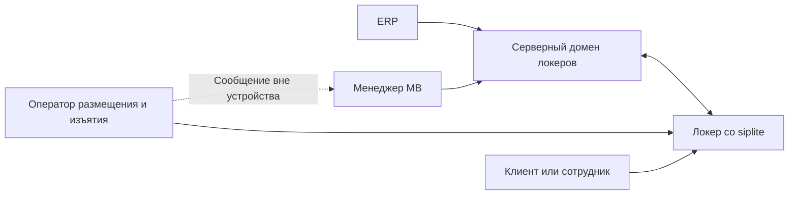
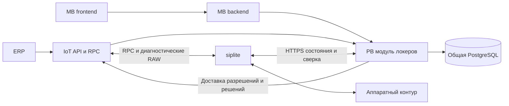
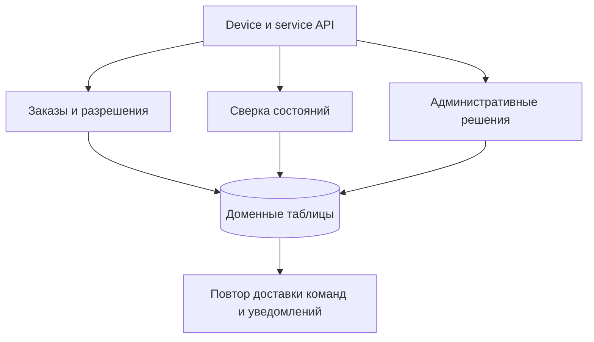
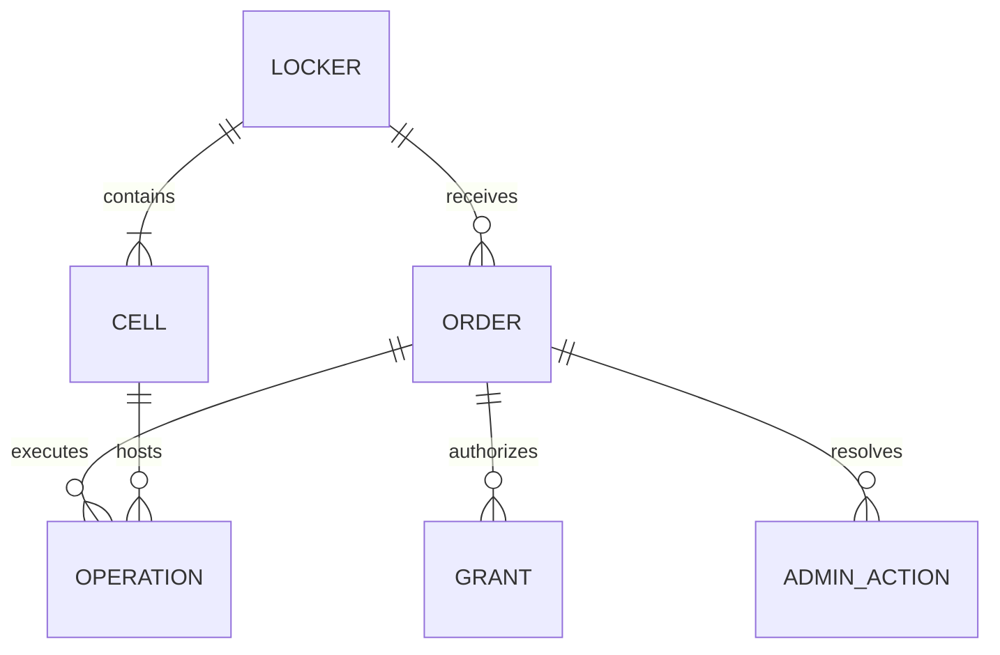
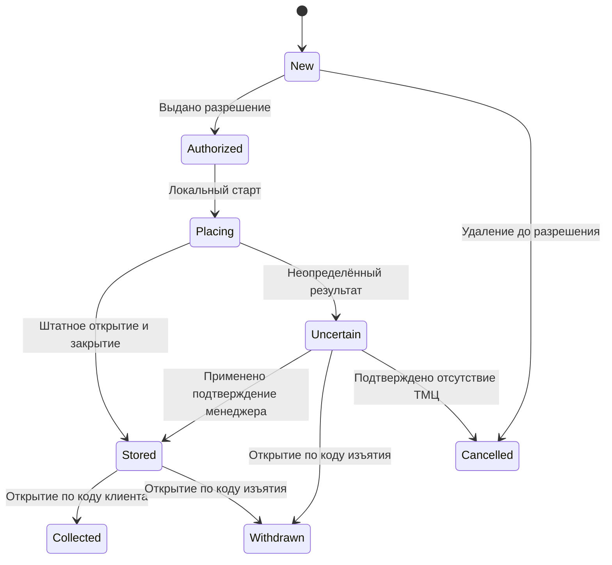
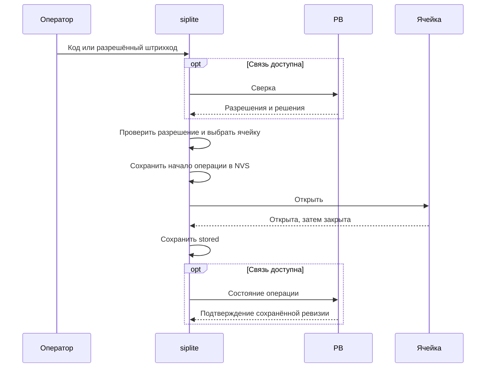
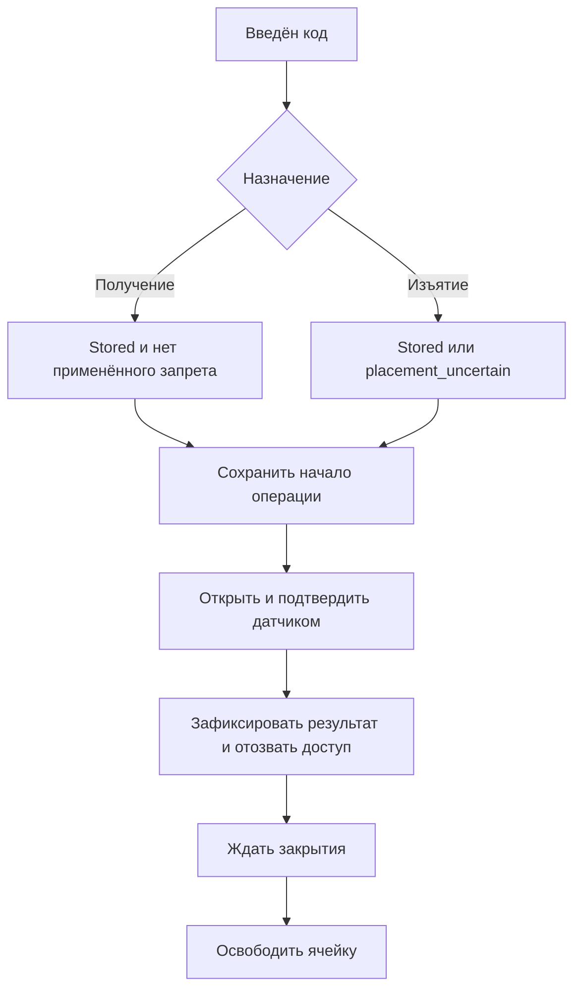
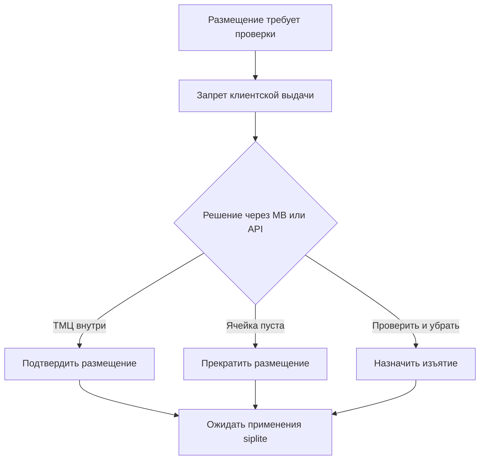

# Архитектура домена локеров

Дата: 2026-10-18. Редакция 1. Статус: согласованные бизнес-правила MVP и проект технических контрактов; реализация не выполнена.

Система управляет размещением, хранением, выдачей и изъятием ТМЦ через локер. Первый запуск тестовый: одна плата, 24 ячейки, ручное прохождение сценариев. Домен размещается в существующих ProcessingBackend, MenuBuilder и IoT; siplite исполняет локальные операции и хранит состояние в NVS.

## 1. Навигация и уровни схем

| Уровень | Содержание | Где читать |
|---|---|---|
| L0 | Участники и граница продукта | Раздел 3 |
| L1 | Ответственность серверов и устройства | Раздел 4 |
| L2 | Размещение, выдача, неопределённость | Разделы 6–8 |
| L2 | Синхронизация и административные решения | [Контракты](etran_arch-lockers-contracts.md) |
| L3 | DTO, версии, ответы, Scalar | [Контракты](etran_arch-lockers-contracts.md) |
| L3 | Гонки, расхождения и действия менеджера | [Эксплуатационная семантика](etran_run-lockers-reconciliation.md) |

Диаграммы намеренно разделены. L0 не описывает транспорт, L1 не перечисляет поля сообщений, L2 показывает отдельный сценарий. Таблицы переходов и контрактов дополняют схемы и определяют поведение при ошибках.

## 2. Принятые решения и границы MVP

### 2.1. Бизнес-правила

1. Поддерживаются выдача клиентам и сотрудникам. Заказ создаёт менеджер роли 6 в MB либо ERP через API. Передача кода человеку выполняется вручную, вне автоматизации MVP.
2. Один заказ связан с одним локером и одной сессией хранения в одной ячейке. Частичная выдача, несколько ячеек на заказ и перемещение между локерами не входят в MVP.
3. Автономное размещение разрешено только для заказа, заранее разрешённого PB к исполнению и сохранённого siplite. Выдача и изъятие работают автономно по сохранённым данным.
4. Начатое разрешённое размещение завершается локально при потере сети.
5. Повторное открытие по использованному коду исключено. Ячейка освобождается после закрытия двери; открытая дверь не считается свободной ячейкой.
6. Успешное размещение требует наблюдений открытия и закрытия в допустимое время. Выдача/изъятие фиксируются по открытию после соответствующего кода. Датчик не доказывает наличие или отсутствие ТМЦ; это принятая учётная модель.
7. При неопределённом размещении клиентский доступ запрещён локально, без ожидания PB. Изъятие по сохранённому коду разрешено, включая автономный режим.
8. Менеджер может подтвердить размещение со слов оператора. Оператор не вводит результат на siplite: доступны только код и датчики, а решения передаются через MB/API.
9. Полная отмена возможна по подтверждению siplite либо административной процедуре: оператор отдельно уведомлён и не размещает ТМЦ. Основание отмены и подтверждение устройства учитываются отдельно.
10. Периодическая сверка выполняется ориентировочно раз в 10 минут и по триггеру размещения. Потеря отдельных онлайн-сообщений компенсируется сохранёнными состояниями, без очереди всех событий на устройстве.
11. RAW-события диагностические, допускают потери. Их отсутствие не блокирует бизнес-переходы. Связь с операцией желательна, но не обязательна.
12. Все допустимые гонки и неоднозначности документируются вместе с условиями возникновения, состояниями обеих сторон и административными рекомендациями.

### 2.2. Что остаётся проектом

Имена DTO, таблиц, маршруты API и конкретная раскладка NVS ниже являются техническим предложением. Числовые RPC/event-коды выделяет владелец IoT до реализации. Тайм-ауты двери, объём предзагрузки, сроки разрешений и лимиты запросов определяются при реализации и ручных испытаниях.

В MVP нет отдельной WMS, автоматических уведомлений клиентам, платежей за хранение, автоматического расследования спорных выдач, гарантированного RAW-журнала и отдельного микросервиса локеров. Формальная программа приёмки будет согласована позже; перечень ручных сценариев не является обязательным gate тестового запуска.

### 2.3. Основания архитектурного выбора

| Вариант | Решение и последствия |
|---|---|
| Модуль локеров в PB | Выбран: существующие FastAPI, PostgreSQL, terminal identity и миграции; требуется изоляция доменных модулей и нагрузки |
| Весь домен в IoT | Не выбран: транспорт стал бы владельцем складских состояний и правил; дублирование серверной бизнес-логики |
| Отдельный сервис и отдельная БД | Отложен: для тестового MVP добавляет deployment, auth и сопровождение |
| Только онлайн-размещение | Заменён согласованным автономным разрешением; проще отмена, но хуже работа при обрыве сети |
| Существующий поиск кода и open_cell без домена | Недостаточен: нет заказов, фаз операций, отмены и сверки |

## 3. L0 — участники

Менеджер управляет заказами и разрешает исключения. Оператор знает соответствующий код; наличие кода не даёт прав менеджера. Клиент получает доступ только к своему заказу. ERP действует в рамках организации и scope API-ключа.

## 4. L1 — компоненты и владение

| Владелец | Данные и действия | Ограничение |
|---|---|---|
| PB | Заказы, разрешения, серверная проекция операций, административные решения, сверка, бизнес-история | Нет пользовательских JWT-маршрутов |
| siplite | Фактическая локальная операция, выбранная ячейка, применённые разрешения и запреты, устойчивые результаты | Не создаёт произвольные заказы; не решает tenant-права |
| IoT | Внешний API-фасад, RPC transport, RAW, внешняя доставка webhook | Не меняет доменные таблицы напрямую |
| MB | JWT, роль 6, API-ключи в существующем контуре, UI и BFF | Команды домена идут через PB; общий ORM не даёт права записи |
| shared | Декларативные модели, ограничения и связи | Без бизнес-логики, криптографии и FastAPI |
| PB Alembic | Единая цепочка миграций общей схемы | Схему внешнего IoT не включать по аналогии |

Сервер владеет намерениями, устройство — наблюдениями физической операции. PB хранит подтверждённую серверную проекцию этих наблюдений, а не перезаписывает их своим более поздним временем запроса.

Авторизация устройства использует существующую проверенную identity/mTLS-границу PB. SN из тела запроса не заменяет аутентифицированную identity. Привязка локера к организации проверяется на сервере. Новые разрешения требуют отдельной доменной проверки допуска; факт распознавания сертификата сам по себе её не заменяет.

### 4.1. Внутренний состав модуля PB

Модули используют текущий стек. Небольшая серверная таблица ожидающей доставки допустима: запрет на очередь каждого события относится к siplite. Состояние заказа и запись о внешнем уведомлении фиксируются одной транзакцией PB. Повторы не создают повторные физические операции.

## 5. Модель данных

### 5.1. Логические сущности

| Сущность | Основные данные |
|---|---|
| Locker | org_id, terminal identity, SN, геометрия, версия карты ячеек, last_sync, storage_generation |
| Cell | Логический номер, координаты, enabled, последнее положение двери и время наблюдения, активная привязка |
| Order | ID, external_id, локер, описание/ID ТМЦ, состояние, server_revision, сроки, предпочтительная ячейка |
| Grant | grant_id, order_id, назначение кода, срок начала размещения, разрешение barcode, версия и факт доставки |
| Operation | operation_id, order_id, grant_id, cell_id, фаза, device_revision, времена наблюдений, причина неопределённости |
| AdminAction | action_id, order_id, operation_id, тип решения, причина, actor, статус доставки/применения |
| BusinessRecord | Принятый переход или решение; correlation, actor, server_received_at, необязательные RAW-ссылки |
| Delivery | Ожидающая доставка разрешения/решения/уведомления, retry и подтверждение |

Это логическая модель, не требование создать по таблице на каждую строку. Для первой реализации допускаются purpose-поля кодов внутри записи разрешения и общая таблица операций с фазами. ORM остаётся тонким.

Инварианты БД и use-case: tenant scope во всех связях; не больше одной незавершённой физической операции на ячейку; не больше одной активной сессии хранения заказа; уникальные operation_id/action_id; одинаковый внешний ID повторного создания не создаёт новый заказ. Назначение конкретной ячейки проверяется siplite непосредственно перед началом: серверная карта может отставать.

Сессия хранения начинается при штатном закрытии после размещения либо при применении подтверждения менеджера; заканчивается при подтверждённом открытии на выдачу/изъятие. Ожидание последующего закрытия относится к освобождению ячейки. Для MVP отдельная таблица сессий необязательна: связь и интервалы могут храниться в заказе/операции. При восстановлении пропущенных состояний точное время начала неизвестно, если устройство его не сохранило; сервер не подставляет время приёма как физическое время.

### 5.2. Три независимых измерения

| Измерение | Значения проекта |
|---|---|
| Жизненный цикл заказа | new, authorized, placing, stored, placement_uncertain, collected, withdrawn, cancelled |
| Намерение менеджера | none, cancel_requested, withdrawal_required, placement_confirm_requested, empty_confirm_requested |
| Физическая ячейка | door=open/closed/unknown; allocation=free/reserved/occupied/awaiting_close/blocked |

Дополнительно: cancel_basis=device/admin_procedure; device_cancel_applied=false/true; applied_action_id; last_seen. Отмена по административной процедуре может иметь lifecycle=cancelled при device_cancel_applied=false. При позднем физическом размещении сохраняется история отмены, lifecycle отражает stored/placement_uncertain, а intent становится withdrawal_required. Нельзя скрывать содержимое за финальным статусом отмены.

Отмена разрешённого заказа и все конкурентные переходы детализированы в реестре расхождений. Диаграмма показывает основной жизненный цикл, а не все административные ветви.

## 6. L2 — размещение

### 6.1. Предзагрузка

PB до отправки фиксирует разрешение исполнения и его связь с одним локером. Повтор доставки несёт тот же grant_id. Потеря ACK означает «возможно доставлено», а не «не доставлено». После передачи заказ уже нельзя безусловно удалить как эфемерный.

Предзагрузка включает данные размещения, получения и изъятия. Разрешение не резервирует физическую ячейку автоматически. Предпочтительный номер — условие допуска, а не доказательство свободного места.

### 6.2. Начало и завершение

Онлайн-сверка имеет ограниченное время ожидания. Транспортный сбой позволяет перейти к сохранённому разрешению; полученный явный запрет PB не разрешает fallback к прежнему коду. Нового локального разрешения при отсутствии записи не создаётся.

Перед физическим действием запись NVS должна успешно завершиться. При ошибке хранения новое открытие не выполняется. После рестарта запись о начатом открытии не является основанием автоматически повторить импульс замку.

Свободной считается ячейка с закрытой дверью, без действующей привязки, без блокировки и без неопределённой операции. Если места нет, возвращается no_capacity: заказ не считается размещённым, код не расходуется как успешный. Если открытие было начато, но физический результат неизвестен, автоматический выбор второй ячейки запрещён.

Штатный цикл open→closed до тайм-аута завершает размещение. После тайм-аута позднее закрытие сохраняет placement_uncertain. Для клиента такой заказ недоступен до применённого подтверждения менеджера.

## 7. L2 — выдача и изъятие

Успешная выдача/изъятие делает все коды завершённой сессии непригодными для повторного открытия. При изъятии из неопределённой ячейки результат withdrawn допустим и для фактически пустой ячейки; это не доказательство наличия ТМЦ перед открытием.

Фаза начала открытия блокирует повторный конкурентный ввод. Если датчик не подтвердил открытие, нельзя объявлять успешную выдачу или автоматически повторять команду после сбоя питания. Сохраняется неопределённый результат физической операции; дальнейшее поведение описано в R11 реестра расхождений.

Если дверь не закрывается после выдачи, заказ остаётся collected/withdrawn, а ячейка — awaiting_close. Позднее закрытие освобождает её без второго бизнес-события выдачи. При неисправности датчика сохраняется blocked.

## 8. L2 — неопределённость и менеджер

Менеджер может действовать со слов оператора; дополнительные доказательства не обязательны для тестового запуска. UI сохраняет автора, причину и основание сообщения. Общее поле PATCH status не предоставляется.

Подтверждение размещения применяется только к ожидаемой операции, закрытой двери и отсутствию текущей неисправности. При открытой двери решение отклоняется, а не превращается в бессрочное разрешение на будущее закрытие. После исправления менеджер отправляет новое действие.

«Прекратить размещение — ячейка пуста» означает явное подтверждение отсутствия ТМЦ. После применения коды заблокированы; позднее закрытие освобождает ячейку. Простая отмена заказа такого подтверждения не содержит.

## 9. NVS и существующий задел siplite

### 9.1. Проверенные точки переиспользования

Статическое чтение локального checkout `D:/esp32-workplace/sip` в ходе проектирования:

| Исходник | Найдено | Граница вывода |
|---|---|---|
| main/l4_input_processing.c | lookup_auth_value, open_cell, cell_map, ввод из frontend | Нет готового жизненного цикла заказа в просмотренном обработчике |
| main/l4_cfg_repo.c | Конфигурация auth_ns/script, пример auth_lockers | Пример sip_no_map относится к SIP-вызову |
| main/leo4_nvs.c | Чтение/запись, блокировка и nvs_commit | Несколько вызовов не образуют общей бизнес-транзакции |
| main/leo4_nvs_handler.c | Общий NVS gateway и закрытые namespaces | Не является готовым доменным API локеров |
| docs/MODULE_MAP.md | PB HTTPS, persistent owner, policy clock | Точки интеграции; пригодность конкретных API нужно проверить перед реализацией |

Текущий input handler ограничивает вход 16 байтами и map_data 16 байтами. Шестизначные коды помещаются, произвольный ТМЦ barcode — не обязательно. Ввод и найденные значения сейчас логируются; для локеров коды и содержимое разрешений нужно исключить из логов и RAW.

### 9.2. Проект хранения

Ключ NVS — до 15 ASCII-символов. Полный order_id, operation_id, barcode хранятся внутри значения, не обрезаются до ключа.

| Namespace проекта | Ключи примера | Назначение |
|---|---|---|
| locker_orders | o0001, o0002 | Одна версионированная запись заказа, разрешения, операции и привязки |
| locker_meta | meta | storage_generation, схема, параметры сверки |
| cfg_locker | layout | Версия геометрии и логических номеров; аппаратное отображение принадлежит устройству |

Имена illustrative, до реализации проверить коллизии. Формат str/blob выбирается с учётом реальных ограничений gateway и размера записи. Новая БД на устройстве не требуется.

Индекс кодов строится в RAM из устойчивых записей. Перебор небольшого набора допустим. Отдельный постоянный индекс не должен становиться вторым независимым источником истины. Карта занятости восстанавливается из операций, затем сверяется с датчиками; противоречия блокируют затронутые ячейки.

Одна согласованная запись содержит фазу операции, ячейку, действующие права и device_revision. Для многозаписного обновления разрешений нужна staging/generation-схема либо независимое применение полных записей; частично принятый набор не объявляется полным снимком. Поведение при потере питания должно быть определено реализацией, а не предполагаться из слова commit.

NVS обновляется при бизнес-переходе, применении решения и изменении значимых настроек. Каждый опрос датчика и каждый heartbeat не записываются во Flash. Подтверждённые завершённые записи очищаются; неподтверждённые не вытесняются. Лимит заполнения запрещает новые размещения, сохраняя возможность безопасно завершать уже занятые ячейки при наличии резерва для записи результатов.

### 9.3. Сроки и перезапуск

Тайм-ауты текущей операции используют монотонное время. Срок разрешения автономного начала требует доверенного времени; при невозможности установить его после перезапуска новое автономное размещение блокируется до восстановления времени/сверки. Уже размещённый заказ не лишается выдачи только из-за истечения срока начала размещения. Это предложенная политика времени, требующая проверки существующего policy clock.

## 10. Коды и идентификатор ТМЦ

Коды — строки из шести цифр, включая ведущие нули. Назначение и локер входят в проверку. При одном поле ввода действующие коды разных назначений на одном локере должны быть различимы без угадывания сценария. Нельзя повторно назначать код, пока устройство может хранить прежнее действующее разрешение.

PB генерирует коды; siplite получает данные, достаточные для автономной проверки. Окончательный формат проверки/хранения определяется до реализации; код не служит NVS-ключом доменного состояния. Просмотр кодов доступен только явно разрешённым ролям, с аудитом; обычные списки, карты, webhook, логи и RAW их не содержат. Нужны ограничение попыток ввода и сохранение запрета повторной успешной операции после рестарта.

ТМЦ ID приобретает смысл только в созданном заказе. Настройка place_by_barcode разрешает использовать его для размещения. Без настройки сканирование не открывает ячейку. Дубликат barcode среди разрешённых заказов одного локера приводит к отказу ambiguous_barcode, а не выбору первого. Штрихкод в этом режиме является средством доступа и также исключается из диагностических payload.

## 11. MenuBuilder и роль 6

Роль 6 предоставляет просмотр локеров и доступных IP-камер, создание заказов, просмотр операций и карты ячеек, изменение разрешённых настроек, административные решения и получение API-ключа через существующий контур. Устройства можно маркировать тегом locker; тег не заменяет tenant authorization.

Экран заказа показывает отдельно: бизнес-состояние, последнее состояние устройства, время наблюдения/сверки, административное намерение, основание отмены и результат применения. «Нет связи» не означает «пусто» или «отменено». Карта содержит 24 ячейки, логические координаты и состояния unknown/open/closed; подсказка раскрывает причину блокировки.

IP-камеры используют существующий разрешённый видеоконтур; просмотр не является доказательством хранения и не становится условием выдачи. Экраны компьютеров и консоль роли 6 не предоставляются. Точный набор общих страниц ролей 3/5 определяется явной матрицей permissions, без наследования всех их полномочий.

## 12. Реализация и тестовый запуск

1. Согласовать технические DTO и RPC/event registry с IoT, форматы NVS и размеры с siplite. Выбрать тип MQTT-клиента по правилам репозитория до его изменения; данный документ нового клиента не создаёт.
2. Добавить shared-модели и additive миграцию PB; выключенный по умолчанию доменный допуск для выбранных локеров.
3. Реализовать PB домен, device/service API и сверку. Затем фасад IoT, изолированный OpenAPI/Scalar и delivery.
4. Реализовать siplite state machine поверх существующих input/NVS/HTTPS, сохраняя аппаратную границу black box.
5. Добавить роль 6, BFF и страницы MB. Запустить выбранные устройства и организации в тестовом режиме.

Совместимость: expand schema → совместимые readers/writers → device capability/version → адресное включение. Старое устройство не получает разрешения неизвестного формата. При откате сервера сначала прекращают выдачу новых разрешений; нельзя просто выключить сервер и считать отозванными автономные коды. Завершают/изымают активные заказы, сверяют состояние, затем отключают домен. Деструктивное удаление схемы не является штатным rollback.

Ручные сценарии: штатные размещение/выдача/изъятие; автономные операции; отмена до/после передачи; тайм-аут и позднее закрытие; три решения менеджера; рестарт вокруг открытия; потерянный HTTP-ответ; устаревшая команда; заполнение NVS; восстановление после потери данных; tenant isolation; изолированный Scalar. Порядок и формальный протокол приёмки определяются позже. Реализационные quality checks остаются обязательными по правилам изменяемых проектов.

## 13. Источники и актуальность

- Исходные требования: [postamats.txt](../plans/postamats.txt), [postamats2.txt](../plans/postamats2.txt); последующий согласованный диалог включён в эту редакцию и имеет приоритет над первоначальным онлайн-only и повторным открытием.
- [Владение БД](etran_data-database-ownership.md), [карточка PB](../.agent-context/components/processing-backend.md), [MQTT matrix](../.agent-context/contracts/mqtt-topic-matrix.md).
- Статические исходники siplite указаны в разделе 9; hardware E2E не заявлен.
- Сверка документа: etranprocessing HEAD b0a4545, working tree, без runtime/deploy. Исходники внешнего IoT для новых API не проверялись.
