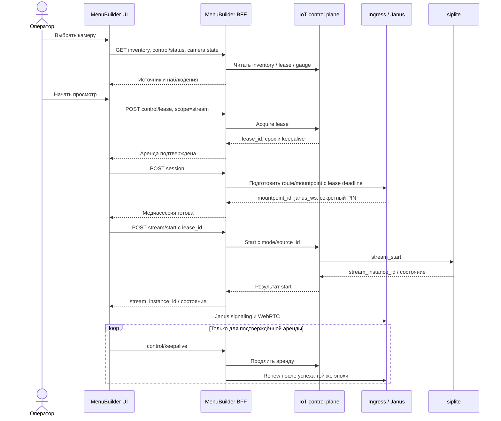
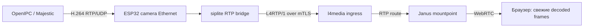
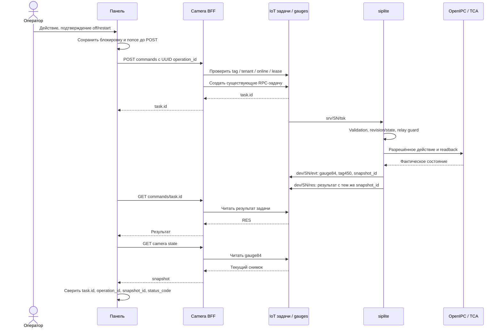

# Флоу камер OpenIPC

Актуально на 2026-10-12: панель MenuBuilder выпущена, прошивка siplite —
`l4-00.02.0018`. Здесь описана существующая реализация; канонические MQTT-контракты
принадлежат IoT. Краткое руководство панели: [Камеры OpenIPC](menu_video-openipc-cameras.md).

## 1. Модель и владельцы

В конфигурации камеры к одному терминалу подключена одна OpenIPC-камера.
В панели она ассоциируется с **номером терминала `device_id`**; локальный
идентификатор siplite — **`cam:ip000001`**. SN используется MQTT и медиатранспортом,
IP — соединением ESP32 с камерой. Эти идентификаторы выполняют разные роли.

Раздел `/cameras` содержит терминалы с точным IoT-тегом **`camera=openipc`**,
включая offline. Имя и адрес берутся из существующей карточки терминала.
Тег обозначает назначение; физическая камера и её исправность проверяются
наблюдениями. ESP32, режим Ethernet или запись в inventory сами по себе
терминал в список камер не включают.

| Компонент | Ответственность |
|---|---|
| MenuBuilder UI | Список, ручной просмотр, действия, подтверждения, возраст данных |
| MenuBuilder BFF | User/tenant/device access, допуск RPC, подготовка медиасессии |
| IoT/app1 | Device tags, control lease, video control, задачи и результаты RPC, gauge84 |
| siplite/ESP32 | Камерная сеть, HTTP-адаптер OpenIPC, RTP relay, readback RPC160..164, gauge84 |
| OpenIPC/Majestic | Кодирование H.264, самостоятельный UDP push, конфигурация и software Day/Night |
| l4media ingress / Janus | Приём L4RTP/1, route/mountpoint, WebRTC |
| ESP32-owned TCA6408A | Выход P3/EN_1_12V питания камеры |

STM32/sip_periph не участвует в управлении OpenIPC и питанием камеры.
ProcessingBackend сохраняет владение выпуском сертификатов; новая панель
не меняет сертификатный flow и не вводит отдельную таблицу камер.

## 2. Создание и аппаратная подготовка

### Создание терминала

1. В настройках терминалов или мастере подключения выбрать **Camera OpenIPC**.
2. UI передаёт `sys="esp32"`, `camera="openipc"` существующему onboarding API.
3. Существующая saga provisioning назначает IoT-теги **`sys=ESP32`** и
   **`camera=openipc`**, сохраняя остальные служебные теги.
4. Выбор сохраняется в audit создания. После сбоя provisioning повтор использует
   тот же терминал и профиль, без выделения второго business record.
5. Продолжить штатную активацию/PIN/сертификатный flow.

Профиль OpenIPC допустим только с ESP32. Обычные Windows/Linux/ESP32 и
исторические записи без профиля камеры сохраняют своё поведение. Существующему
терминалу назначение задаётся явно через штатное управление тегами.

**Назначение тегов не настраивает NVS, DHCP, кабели или Majestic.**

### Сеть и RTP-источник

Текущий HTTP-адаптер требует `cfg_eth/eth_port_mode=1`:

| Логический интерфейс | Назначение | Использованные defaults |
|---|---|---|
| Port1 / `ETH_0` | Uplink в общую LAN | DHCP-клиент |
| Port2 / `ETH_1` | Сеть камеры | ESP32 `192.168.77.1/24`, DHCP-сервер |
| OpenIPC | DHCP-клиент камерной сети | Обычно `192.168.77.2` |

Адрес/маска ESP32 настраиваются. Физические разъёмы сопоставлять с logical ports
по link-событиям/UART: подпись на плате не является доказательством. Uplink
на камерном порту может выставить DHCP-сервер ESP32 в общую LAN.
Изменение сети выполняется отдельным обслуживанием с проверкой доступности
терминала после применения.

HTTP соединение привязано к `ETH_1`; peer должен находиться в его подсети.
`cfg_cam/ip` задаёт адрес, default — `192.168.77.2`. При наличии `cfg_cam/mac`
адрес определяется по DHCP-аренде. `cfg_cam/user` и `cfg_cam/password` используются
только для авторизации камеры и не публикуются в gauge/UI.
`cfg_cam/writer` явно выбирает `post-json` либо `legacy-set`; после неудачной
записи автоматической смены writer нет. В switch-режиме0 HTTP-адаптер
возвращает явную недоступность камерной сети.

Majestic самостоятельно отправляет H.264 RTP/UDP на камерный адрес ESP32 и
`cfg_rtp/rtp_src_port`: обычно **`192.168.77.1:62800`**. siplite принимает UDP
и не открывает RTSP-сеанс. В целевом RTP transport mode1 данные пересылаются
через L4RTP/1 over mTLS; это отдельная настройка от Ethernet port mode.
Адрес legacy Janus в настройках камеры не направляет пакеты в ESP32.

## 3. Просмотр: inventory → lease → session → stream_start

На desktop список слева, справа плеер и настройки; на телефоне список открывается
кнопкой. Выбор камеры и чтение состояния не запускают трансляцию.
Оператор вручную нажимает **«Начать просмотр»**.



Камерный источник: **`mode="usb-camera"`**, **`source_id="cam:ip000001"`**.
`stopped` — состояние потока; допустимые mode — desktop/usb-camera.
Generic source/profile selectors в панели камер скрыты: качество меняется RPC163.

**Route-before-start:** медиамаршрут и mountpoint готовы до включения relay.
App1 владеет lease; media plane использует его deadline. Секретный PIN привязан
к медиасессии. Viewer вручную получает scope `view` для подключения к уже
запущенному потоку; stream_start, настройки и mouse/key ему недоступны.



## 4. Остановка, expiry и старые сессии

«Остановить просмотр» завершает текущую клиентскую сессию/keepalive, останавливает
принадлежащий ей поток, освобождает lease и выполняет media cleanup по IDs.
Viewer завершает свой просмотр; API отдельно проверяет право остановки потока.
Переключение камеры/unmount также запускает cleanup текущей сессии.
Чужая аренда автоматически не завершается для применения настроек.

Если браузер исчез без cleanup, lease deadline и media watchdog ограничивают
жизнь потока/маршрута. Media renew выполняется после успешного keepalive app1,
при совпадении эпохи; истекшая медиасессия не оживляется renew.

Старые хвосты согласуются существующими механизмами:

- Ingress при start/health завершает уже истекшую медиасессию перед reuse/conflict
  checks. Неистекшая сессия продолжает защищаться от конфликтного start.
- BFF сверяет старую DB video session с app1. Подтверждённое отсутствие аренды,
  stopped/failed либо running другой эпохи позволяет закрыть старый хвост по
  `expected_provider_session_id`, с причиной `provider_end_unconfirmed`.
  Подтверждённое время окончания не выдумывается.
- Неясное состояние даёт `video_session_state_unconfirmed`; изменившаяся во
  время reconciliation запись — `video_session_changed_during_reconcile`.
  Console session не закрывается video reconciliation.

Возраст записи или HTTP-ошибка сами по себе не разрешают удалять активную
сессию. Общий контракт: [video-streaming](../.agent-context/contracts/video-streaming.md).

## 5. Управление: одна команда → /res + gauge84

Перед изменением оператор останавливает просмотр. BFF допускает запись при
подтверждённом online и `lease_active=false`; неизвестная аренда блокирует запись.
Сервер проверяет tenant/device/tag и active admission. Firmware держит общий
exclusive relay guard на всю операцию: он закрывает гонку с новым stream_start.

| Действие панели | RPC | Значения и предусловия |
|---|---|---|
| Обновить состояние | 160 | Чтение; оператору не нужна свободная аренда |
| Качество | 163 | medium/hd, свежие config/revision, capability |
| День / ночь | 162 | auto/day/night, свежие config/revision, capability |
| Питание | 164 | on/off/restart, свежий power readback и expected_power_on |

Изменение требует `allow_disruptive=true`. Питание можно включить при недоступной
OpenIPC, если online ESP32, свободная аренда и свежий power probe подтверждены.
RPC161 существует для approved config patch, но произвольная форма параметров
в нынешнюю панель не входит. Неподдерживаемые capability блокируют кнопки.



Каждая принятая устройством операция готовит результат и снимок, включая
unsupported и ошибки. Ошибка допуска BFF до создания задачи gauge не порождает.
`event_delivery="queued"` подтверждает постановку в очередь устройства;
доставку доказывает соответствующий gauge на сервере.

### Корреляция и потерянный ответ

UUID браузера `operation_id` передаётся в IoT как **`ext_task_id`**.
IoT возвращает **`task.id`** — именно он становится `operation_id` в gauge450
и используется для чтения результата. Два UUID могут отличаться.
`snapshot_id` результата `/res` должен совпасть со snapshot gauge той же задачи.
Task DONE может содержать отрицательный RES; UI проверяет `status_code` и JSON.
REST результат и gauge могут появиться в разном порядке.

UI ждёт результат до 45 секунд, затем matching gauge до 10 секунд. При потерянном
POST-ответе задача могла быть создана: автоматического повтора нет, включая
общий auth retry после HTTP401. Блокировка на 90 секунд сохраняется **до POST**
в sessionStorage вкладки/tenant/device и переживает reload. BFF задаёт `ttl=1`
(минута), timeout устройства 15000мс. Истечение блокировки не подтверждает успех:
перечитать состояние и проверить известную задачу перед новым действием.
`ext_task_id` не гарантирует серверную идемпотентность; RAM-кеш задач ESP32
не обещает дедупликацию через перезапуск устройства.

## 6. Семантика действий

### Качество

| Preset | Размер | FPS | Bitrate, кбит/с | rcMode | GOP, секунды |
|---|---|---|---|---|---|
| Medium | 640×360 | 10 | 768 | vbr | 1.0 |
| HD | 1280×720 | 15 | 1024 | vbr | 1.0 |

Это утверждённые product presets. Firmware проверяет все поля по schema/policy
и writer-профилю до первой записи, затем сверяет readback. Unsupported поле
отклоняет весь preset: молчаливого пропуска параметров с успехом нет.
Настроенный FPS/bitrate и измеренная скорость кадров — разные значения.

### Auto / Day / Night

Auto включает и сверяет `nightMode.lightMonitor=true`. Day/Night отключает
автомонитор, вызывает фиксированный `/night/off` или `/night/on`, сверяет
`night_enabled`. Неоднозначная команда вслепую не повторяется; partial apply
отражается в результате и снимке.

Software mode и физическое движение фильтра проверяются отдельно.
`ircut_enabled` не доказывает движение. ИК-подсветка к проверенной камере не
подключена и в панель не входит; pin/GPIO, пороги, сеть и credentials не
являются её пользовательскими командами.

### Питание EN_1_12V

RPC164 действует только на **P3 TCA6408A, mask0x08, active HIGH**, сохраняет
остальные биты и сверяет `expected_power_on`. Общий guard блокирует изменение
при активном/останавливающемся RTP relay.

- on/off устанавливают состояние; совпадающее возвращает unchanged.
- restart требует исходного on и достаточного deadline, выключает выход
  на 3000мс, затем включает. После возможного off firmware пытается вернуть on;
  неподтверждённый шаг означает outcome_unknown, без слепого повтора цикла.
- off/restart требуют подтверждения оператора в UI.
- Bootstrap firmware включает питание камеры при старте.

Readback подтверждает output latch и направление P3; измерения напряжения 12V
нет. После on/restart дождаться загрузки, выполнить RPC160 и проверить поток.
Снимок power-операции может иметь unknown config/health до чтения OpenIPC.

## 7. Gauge84, свежесть и состояние

IoT хранит IPCamera как **текущий gauge типа84**, тег **450** в группе300.
По стандартной конфигурации запись в device-events journal не создаётся.
Читать `GET /api/v1/gauges/?device_id=<id>&type=84`; camera BFF возвращает
разобранный `snapshot`. Последующий periodic/RPC снимок может заменить gauge:
correlation IDs необходимо проверять.

| Поле снимка | Смысл |
|---|---|
| snapshot_id | Идентификатор снимка |
| operation_id | IoT task.id для RPC; null для фонового чтения |
| observed_at / freshness_max_age_sec | Время наблюдения и предел возраста |
| cameras[].config / revision | Approved настройки и их SHA-256 |
| cameras[].capabilities | Поддержка действий, пресеты и условия доступности |
| cameras[].power | Выход питания со своей давностью |
| cameras[].identity | Версии OpenIPC/Majestic, status и observed_at |
| cameras[].telemetry / telemetry.health | Software night и health probes со своей давностью |
| cameras[].last_operation | Outcome и причина отказа последней операции |

ESP32 читает камеру примерно каждые 300 секунд с jitter; открытая панель читает
серверный gauge каждые 5 секунд, без RPC. Кнопка refresh отправляет RPC160.
Consumer считает возраст по доверенному UTC: default 330 секунд; `stale=true`
или превышение возраста — stale, отсутствующий/failed probe — unknown,
время более 5 секунд в будущем — clock_invalid. Старый `stale=false` не делает
сохранённый gauge бессрочно актуальным. Config и power проверяются раздельно.

В «Подробностях»: версии, температура, память, uptime, clock diagnostics.
Uptime вычисляется из согласованных показаний самой камеры. Обнаруженное
расхождение её часов с ESP32 не запускает синхронизацию времени.

| Сигнал | Что подтверждает |
|---|---|
| Terminal/control online | Доступность соответствующего канала ESP32 |
| Power on | Установлен выход EN_1_12V |
| OpenIPC ready / read_only | Успешное управление чтением; права записи различаются |
| Relay running / mTLS connected | Работа relay/туннеля |
| Рост RTP counters | Поступление пакетов на этом участке |
| Свежие decoded frames / video callbacks | Браузер получает и декодирует текущие кадры |

«В эфире» требует свежих decoded frames. Running, успешный signaling или
накопленный RTP counter отдельно не подтверждают текущее изображение.

## 8. API и права

Camera BFF: **`/api/cameras`**; video API: **`/api/v1/video/devices/{device_id}`**.
Axios с baseURL `/api` использует соответственно `/cameras/...` и `/v1/video/...`.

| Метод и путь | Назначение |
|---|---|
| GET /api/cameras/{id} | snapshot, terminal_online, lease_active |
| POST /api/cameras/{id}/commands | Допуск и создание фиксированной camera RPC |
| GET /api/cameras/{id}/commands/{task_id} | Результат задачи данного устройства и разрешённого method_code |
| GET /api/v1/video/devices/{id}/inventory | Источники |
| GET .../control/status | Agent / lease |
| POST .../control/lease | Acquire scope stream/view |
| POST .../session | Подготовить/получить медиасессию |
| POST .../stream/start, POST .../stream/stop | Управление потоком |
| POST .../control/keepalive, DELETE .../control/lease/{lease_id} | Renew / release |

Пример camera commands refresh; UUID иллюстративный, клиент создаёт новый:

```json
{"operation_id":"11111111-1111-4111-8111-111111111111","action":"refresh"}
```

quality требует value medium/hd, текущую `expected_revision` и consent;
day_night — value auto/day/night с теми же условиями;
power — value on/off/restart, свежий boolean `expected_power_on` и consent.
Неизвестные поля запрещены; browser не задаёт произвольный method_code,
camera URL или shell-команды.

Чтение состояния требует `video:view` и terminal access в tenant. Команды,
включая refresh, и commands results требуют operator role. Server guard
допускает роли 1/2/3/5 в разрешённом tenant; Viewer4 не отправляет RPC.
Membership и права проверяются на каждой операции. Блокировка кнопки не
заменяет серверную проверку. Credentials портала/камеры не включать в gauge,
логи, документы и сохранённые примеры приёмки.

## 9. Отказы и диагностика

| Ситуация | Результат / следующий шаг |
|---|---|
| Нет camera=openipc | Camera API404; проверить явное назначение |
| Истекла сессия портала | HTTP401; обычный вход, без автоматического replay команды |
| Нет operator права / чужой tenant | HTTP403; восстановить разрешённый доступ |
| Online не подтверждён | HTTP409 camera_terminal_offline для записи |
| Lease активная/неизвестная | HTTP409 camera_busy; остановить свой просмотр или выяснить состояние |
| Config изменился | RPC409 revision_conflict; перечитать snapshot |
| Нет поддержки команды | RPC501 unsupported; явная причина, capability вместо crash/skip |
| Camera auth ошибочна | auth_failed; отдельно проверить credentials OpenIPC |
| Partial write / mismatch | partial_apply / verify_failed; оценить фактический снимок |
| Возможно применено, ответа нет | outcome_unknown / camera_request_unconfirmed; read-only reconciliation |
| Gauge enqueue failed | snapshot_publish_failed; outcome записи проверить отдельно |
| Старая медиасессия | Сверить lease/эпоху и media expiry, не удалять активную сессию вручную |

При отсутствии потока проверять по порядку:

1. Terminal online, права, inventory и соответствие logical uplink/camera ports.
2. DHCP камеры, ETH_1, power readback и readiness RPC160.
3. RTP destination Majestic: ESP32 и входной UDP-порт.
4. siplite rx/fwd/drop, Ethernet dma_missed/fallback, затем ingress RTP counters.
5. Route/mountpoint, lease deadline, актуальные session/stream IDs.
6. Janus signaling/ICE и рост decoded frames браузера.

При подмораживании сопоставлять потери по этим участкам, особенно IDR bursts.
Camera RX и крупные HTTP-буферы используют PSRAM. UDP bridge имеет bounded
receive budget **64×1472 байт** и mailbox 64 пакета: рост только byte budget
сверх ограничения mailbox не увеличивает ёмкость в пакетах. Изменения буферов
оценивать вместе с потерями, задержкой и памятью; отсутствие источника или
неправильный RTP destination ими не исправляется.

## 10. Приёмка и источники

На 2026-10-12 подтверждены: профиль создания/retry provisioning тестами,
отсутствие autostart/POST replay, refresh RPC160 + matching gauge,
реальный отказ 409 camera_busy. Оператор ответил «Есть» для потока 4619
из нового раздела. Пресеты, software Day/Night и питание проверены на 0018;
цвет менялся, звук движения фильтра не подтверждён. На 4623 камеры нет.
Production test terminal ради проверки не создавался.

При новой физической приёмке согласовать остановку просмотра и готовность
наблюдать фильтр. Software readback, цвет и звук фиксировать отдельно;
для потока получать явное «Есть/Нет». Пятиминутный прогон и ИК-подсветка
не входят в согласованный этап. SHA/digests, задачи и evidence:
[handoff панели](../.agent-context/tasks/active/2026-10-11-camera-panel.md).

Точки изменения и источники истины:

- [Onboarding](../MenuBuilder/backend/app/services/terminal_onboarding_service.py): профиль, audit и saga tags.
- [Camera BFF](../MenuBuilder/backend/app/routers/cameras.py), [IoT bridge](../MenuBuilder/backend/app/services/camera_platform.py): admission, RPC mapping, gauge.
- [CameraSettings](../MenuBuilder/frontend/src/components/video/CameraSettings.tsx), [freshness](../MenuBuilder/frontend/src/utils/cameraState.ts): result/gauge, lock и возраст.
- [Video page](../MenuBuilder/frontend/src/routes/video-surveillance.tsx), [control BFF](../MenuBuilder/backend/app/routers/video_control.py), [media BFF](../MenuBuilder/backend/app/routers/video.py): lease/session/start/stop.
- [Media architecture](etran_arch-l4media-streaming-architecture.md), [video-streaming](../.agent-context/contracts/video-streaming.md): транспорт и lifecycle.
- IoT canonical: [RPC160..164](https://github.com/OlegLebedevRU/iot-rpc-rest-app/blob/master/docs/method-codes-reference.md), [gauge450](https://github.com/OlegLebedevRU/iot-rpc-rest-app/blob/master/docs/event-property-tags.md), [events/gauges](https://github.com/OlegLebedevRU/iot-rpc-rest-app/blob/master/docs/2-events-api-format-description.md).
- Firmware: [camera adapter](https://github.com/OlegLebedevRU/siplite/blob/master/main/l4_ip_camera.c), [video control](https://github.com/OlegLebedevRU/siplite/blob/master/main/l4_video_ctl.c), [RTP bridge](https://github.com/OlegLebedevRU/siplite/blob/master/main/l4_rtp_bridge.c), [Ethernet](https://github.com/OlegLebedevRU/siplite/blob/master/main/leo4_eth_two_ports.c).
- [Firmware diagnostics/power acceptance](https://github.com/OlegLebedevRU/siplite/blob/master/docs/camera-diagnostics-power.md): P3 и пределы физических доказательств.

Новый MQTT method/event/tag сначала фиксируется upstream в IoT; новый
STM32/I²C-протокол — в sip_periph. Этот документ описывает существующие контракты.
