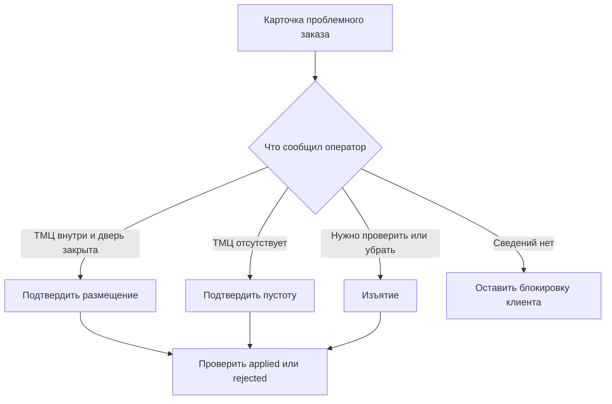

# Расхождения состояний локеров и административные процедуры

Дата: 2026-10-18. Редакция 1. Нормативная семантика согласованного MVP; интерфейсы ещё не реализованы. [Архитектура](etran_arch-lockers-mvp.md), [API и сверка](etran_arch-lockers-contracts.md).

## 1. Общее правило

Каждое допускаемое расхождение описывается в контексте возникновения: известные факты PB и siplite, влияние на доступ и занятость, автоматическое восстановление, действия менеджера и остаточный риск. Новый случай нельзя скрыть за общим статусом error или разрешить универсальным last-write-wins.

В MB рядом показываются бизнес-состояние, административное намерение, состояние устройства, свежесть наблюдения и результат применения решения. Необновлённая карта не доказывает свободное место. Подтверждение менеджера не является показанием датчика.

## 2. Реестр

### R01 — разрешение отправлено, подтверждение потеряно

- Возникновение: PB сохранил grant и отправил его, ACK не получен.
- PB: authorized, доставка неизвестна. siplite: разрешение может уже быть сохранено и исполняться.
- Поведение: не считать заказ эфемерным; повторять тот же grant_id, не выдавать второй код/локер.
- Сверка: устройство возвращает сохранённое разрешение или результат операции; PB уточняет доставку.
- Менеджер: при отмене уведомить оператора; ждать технического подтверждения либо оформить процедуру.
- Остаточный риск: автономное начало до получения отмены. Потеря ACK не устраняет этот риск.

### R02 — удаление конкурирует с выдачей разрешения

- Возникновение: DELETE new и authorize одновременно на PB.
- Поведение: одна серверная транзакционная граница/блокировка определяет победителя. Delete первым запрещает authorize; authorize первым переводит delete в 409.
- Менеджер: после authorize использовать отмену, не повторять жёсткое удаление.
- Остаточный риск: после выдачи разрешения серверная блокировка уже не сериализует автономные действия устройства; действует R03.

### R03 — отмена конкурирует с автономным размещением

- Возникновение: siplite offline с действующим grant, PB принял cancel.
- PB: cancel_requested. siplite: authorized/placing/stored до получения решения.
- Доступ: до применения отмены устройство может разместить, а при штатном размещении — выдать по ещё действующему коду. Мгновенный отзыв не гарантируется.
- Сверка: если движения нет — отменить; если размещено — сохранить занятость, запретить клиентский доступ после применения и потребовать изъятие; уже состоявшуюся выдачу не откатывать.
- Менеджер: сразу отдельно уведомить оператора не размещать. При уже размещённом заказе организовать изъятие, не полагаться на один серверный статус.
- Остаточный риск: физическое движение в допустимом окне отмены. Выдача до применения запрета также возможна и должна быть видна в истории как гонка, а не переписана в отмену.

### R04 — отмена завершена административно

- Возникновение: менеджер подтвердил, что оператор уведомлён и не будет размещать.
- PB: cancelled, cancel_basis=admin_procedure. siplite: отмена может ещё не применяться.
- Поведение: device_cancel_applied показывается отдельно; доставка технической отмены продолжается.
- Если пришло позднее размещение: сохранить факт, перевести в withdrawal_required, показать «размещён после отмены».
- Менеджер: проверить сообщение оператора и фактический локер; организовать изъятие при необходимости.
- Остаточный риск: ошибка коммуникации и действующий код до синхронизации. Административная отметка не доказывает техническую блокировку.

### R05 — размещение не завершилось вовремя

- Возникновение: открыли дверь, но нет закрытия в окне; либо результат открытия неизвестен.
- siplite: placement_uncertain, клиент запрещён, ячейка не free. PB может ещё видеть authorized/placing.
- Сверка: PB принимает неопределённость; отсутствующие RAW не мешают.
- Менеджер: связаться с оператором; выбрать подтверждение размещения, подтверждение пустоты или изъятие.
- Остаточный риск: система не знает содержимое и не устанавливает факт постороннего доступа.

### R06 — позднее закрытие неопределённого размещения

- Возникновение: после R05 датчик сообщил closed.
- Поведение: обновить sensor state, сохранить placement_uncertain и запрет клиента. Автоматического приглашения клиента нет.
- Менеджер: подтвердить размещение только после сообщения оператора о наличии ТМЦ; допустимо действовать со слов оператора.
- Остаточный риск: человеческая ошибка подтверждения; датчик подтверждает только дверь.

### R07 — подтверждена пустота, дверь ещё открыта

- Возникновение: применено confirm_empty для проблемного размещения.
- PB/siplite: заказ cancelled, коды заблокированы; ячейка awaiting_close.
- Позднее закрытие: free при отсутствии fault и других привязок.
- Менеджер: подтвердить отсутствие/удаление ТМЦ, добиться закрытия; при неисправном датчике вывести ячейку из работы.
- Остаточный риск: ложное подтверждение пустоты. Обычный cancel не эквивалентен confirm_empty.

### R08 — изъятие неопределённого заказа без связи

- Возникновение: оператор применяет сохранённый код изъятия при placement_uncertain.
- siplite: допускает изъятие без отдельного решения MB; после подтверждённого открытия фиксирует withdrawn, отзывает доступ, ждёт закрытия.
- PB: может ещё показывать проблему; следующая сверка принимает результат.
- Менеджер: не отправлять повторное открытие из-за задержки PB. Если ячейка была пустой, withdrawn всё равно допустимый результат этой процедуры.
- Остаточный риск: результат не подтверждает, что ТМЦ физически находилось внутри.

### R09 — выдача состоялась, сервер не получил результат

- Возникновение: выдача/изъятие offline либо потерян HTTP-ответ.
- siplite: collected/withdrawn, код больше не действует; при закрытии ячейка свободна. PB: stored или старое состояние.
- Сверка: принять конечный результат по operation_id/revision, ACK после commit. Не загружать старый stored поверх него.
- Менеджер: учитывать свежесть карты; не выдавать повторный код для устранения задержки отображения.
- Остаточный риск: до сверки внешняя система видит устаревший статус. Неподтверждённый результат сохраняется независимо от повторного использования ячейки другим заказом.

### R10 — дверь осталась открыта после выдачи

- Возникновение: результат выдачи уже подтверждён открытием, закрытия нет.
- Поведение: заказ завершён, ячейка awaiting_close; сигнализация о времени открытой двери. Позднее закрытие освобождает её, не создавая вторую выдачу.
- Менеджер: организовать закрытие; при fault — обслуживание.
- Остаточный риск: предмет мог остаться внутри, это не выявляется датчиком. Автоматизация споров не входит в MVP.

### R11 — перезапуск или сбой записи вокруг открытия

- Возникновение: intent сохранён, импульс мог пройти, но наблюдение/результат не сохранён; либо сбой NVS после физического движения.
- Поведение: не повторять открытие автоматически; сохранить/восстановить признак неопределённости, блокировать обычную клиентскую операцию и новое назначение ячейки.
- Сверка: сообщить фазу и причину; не объявлять успешную выдачу только по факту отправки команды.
- Менеджер: проверить содержимое и состояние двери, затем применить адресное решение. Для неопределённого размещения допустимо изъятие по коду; при неопределённой выдаче автоматический повтор не разрешён.
- Остаточный риск: точный момент физического движения без устойчивого результата неизвестен. Процедуру восстановления неопределённой выдачи следует материализовать при реализации, без произвольной кнопки «повторить выдачу».

### R12 — устаревшее административное действие

- Возникновение: action пришёл после выдачи, нового назначения или изменения операции.
- Поведение: сравнить order_id/grant_id/operation_id и допустимую фазу; вернуть rejected со stale_context. Не применять к текущему содержимому ячейки по одному cell_id.
- Менеджер: обновить карточку заказа, выяснить фактическое состояние; отправить новое осмысленное действие при необходимости.
- Остаточный риск: до чтения rejection UI показывает pending; pending не означает разрешённую выдачу.

### R13 — рассогласованная карта или неполный снимок

- Возникновение: PB считает free, устройство occupied; запись отсутствует; sync оборвался между страницами.
- Поведение: не освобождать по отсутствию. При спорной привязке блокируется затронутая ячейка; остальные продолжают работу.
- Сверка: получить complete snapshot и связанные записи операций. Повтор не должен дублировать выдачу или очищать неподтверждённые результаты.
- Менеджер: при устойчивом конфликте проверить физическую ячейку и сообщения оператора.
- Остаточный риск: актуальный снимок двери не доказывает содержимое; иногда требуется административная сверка.

### R14 — потеря NVS или замена устройства

- Возникновение: новая storage_generation, прежние права и фазы утрачены.
- PB: содержит заказы. siplite: не имеет достоверной карты занятости.
- Поведение: запрет новых размещений и автоматического восстановления доступа из старого снимка. Не интерпретировать пустой список как пустой локер.
- Менеджер: провести физическую сверку содержимого, восстановить привязки через согласованную процедуру и только затем вернуть работу.
- Остаточный риск: автономная выдача при утрате её локальных данных не гарантируется; это предел автономности. Процедура восстановления/замены требует отдельной реализации, не скрытого auto-repair.

### R15 — заполнение локального хранилища

- Возникновение: предзагрузка и неподтверждённые результаты исчерпали лимит.
- Поведение: не вытеснять результаты и активные заказы; остановить новые размещения, использовать зарезервированную ёмкость для завершения занятых ячеек.
- Менеджер: восстановить связь и дождаться подтверждения/очистки; не очищать namespace вручную.
- Остаточный риск: доступность новых размещений снижается. Размер резерва определяется измерениями до реализации.

### R16 — неисправный датчик или неожиданное открытие

- Возникновение: изменение двери вне операции, unknown sensor, противоречивые показания.
- Поведение проекта: блокировать ячейку и клиентский доступ при сомнении в сохранности; хранить sensor fault отдельно от состояния заказа. Само закрытие не снимает административную неопределённость.
- Менеджер: проверить содержимое и исправность, затем подтвердить размещение либо организовать изъятие/освобождение.
- Остаточный риск: по одному датчику нельзя различить механический дефект и посторонний доступ. Точные аппаратные признаки определяются контрактом black box.

## 3. Процедуры менеджера

### 3.1. Подтверждение размещения

1. Открыть заказ и проверить локер, ячейку, причину неопределённости и свежесть данных.
2. Получить сообщение оператора: ТМЦ внутри, дверь закрыта. Допускается подтверждение со слов, без автоматизированного расследования.
3. Выбрать «Подтвердить размещение», указать основание.
4. До applied показывать pending; клиентский код на устройстве остаётся запрещённым.
5. Если siplite отклонил решение из-за открытой двери/fault/другой операции, устранить причину и создать новое действие.

### 3.2. Прекращение размещения с пустой ячейкой

Оператор сообщает, что ничего не оставлено или всё убрано. Менеджер выбирает отдельное «Прекратить размещение — ячейка пуста». После применения закрытая исправная ячейка освобождается; открытая ожидает закрытия. Простая отмена заказа не выполняет эту процедуру автоматически.

### 3.3. Изъятие

При stored или placement_uncertain оператор использует сохранённый код изъятия. Предварительная команда MB для неопределённого размещения не обязательна. Менеджер при необходимости запрещает клиентскую выдачу через require_withdrawal; запрет действует после применения устройством. После открытия результат withdrawn, после закрытия ячейка свободна. Если физический результат неизвестен, применяется R11.

### 3.4. Административная отмена

Менеджер отдельно уведомляет оператора не размещать и фиксирует факт сообщения. MB показывает cancelled по процедуре вместе с неподтверждённой технической отменой. Доставка отмены продолжается. Если оператор уже разместил — фактический результат сохраняется, назначается изъятие. Серверная отметка не освобождает физически занятую ячейку.

## 4. L2 — выбор процедуры

## 5. Человеческие тайминги

Период сверки порядка 10 минут не является обещанием применения отмены за 10 минут: offline может продолжаться дольше. Ожидание 10–60 минут допустимо для организационной сверки, но не служит доказательством отмены. Просрочка хранения создаёт уведомление менеджеру, не освобождает ячейку и не расходует код автоматически.

Тайм-аут операции двери независим от периода sync. Его выбирают под реальный сценарий оператора и аппаратный контракт. Изменение общих defaults не меняет выданные разрешения без явной процедуры.

## 6. Ручное прохождение тестовых сценариев

Для каждого выбранного сценария удобно записывать: ID заказа/операции, исходное состояние PB и устройства, действие, наблюдение двери, состояние MB до/после sync, применённую административную процедуру. Коды и credentials в отчёт не включаются.

Рекомендуется начать со штатного цикла, затем R03, R05–R10, после этого рестарт и частичная доставка. Формальная обязательная приёмка сейчас не установлена; результат ручного теста не означает проверку остальных сценариев. Новое обнаруженное расхождение добавляется в этот реестр до назначения ему автоматического поведения.
